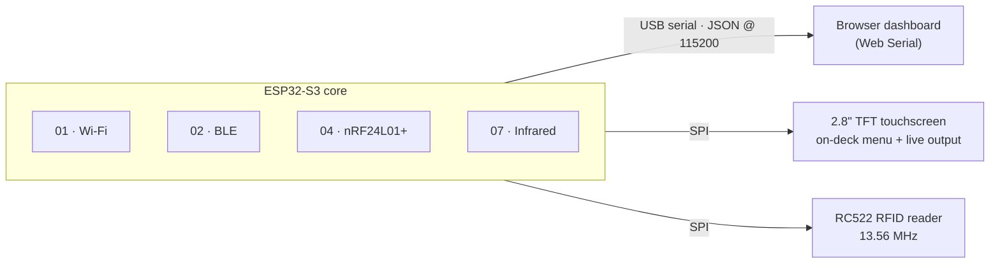

<p align="center">
  
</p>

<h1 align="center">Cyberdeck · ESP32-S3</h1>

<p align="center"><em>by <strong>Sannidhya Biswas</strong> &amp; <strong>Jyotiraditya Kansal</strong></em></p>

<p align="center">
  A pocket-size, open-source field deck for wireless and physical security auditing.<br>
  One ESP32-S3 listens across Wi-Fi, Bluetooth, 2.4&nbsp;GHz, infrared and 13.56&nbsp;MHz RFID, and streams every reading to a live browser dashboard. A built-in 2.8" touchscreen now runs the deck on its own, with Wi-Fi and BLE on-deck today.
</p>

<p align="center">
  <a href="https://rronium.github.io/cyberdeck-esp32s3/"></a>
  
  
</p>

---

## Live dashboard

**👉 [rronium.github.io/cyberdeck-esp32s3](https://rronium.github.io/cyberdeck-esp32s3/)**

The welcome page introduces the deck; **Try it** opens the dashboard. It also carries **the field manual** — a reference below the subsystem cards that explains all 30 implemented functions in depth (what each does, what every telemetry field means, an example of the live output) and links straight to each function's standalone `.ino` on GitHub. Plug the ESP32-S3 into your computer over USB, click **Connect USB serial**, pick a module and press **Start module**. Drag the edges between panes (sidebar | telemetry | serial console) to resize them; no pane grows past 75% of the space, sizes are remembered, and double-clicking an edge resets it. Each pane has a **Clear** button, and nRF24 module 4.1 draws a live spectrum graph (bars, peak hold, waterfall) instead of a table, while the raw JSON still scrolls in the serial console.

> Web Serial only works in desktop **Chrome** or **Edge**. The page talks to the board plugged into *your* computer; nothing is sent to a server.

Every push to `main` that touches `dashboard/` redeploys the site through GitHub Actions ([`.github/workflows/pages.yml`](.github/workflows/pages.yml)).

## How it fits together



The browser sends `{"module": "7.4", "action": "START"}` and the board answers with lines like `{"module": "7.4", "status": "ok", "data": {...}}`.

## Subsystems

| | Subsystem | Hardware | Status |
|---|---|---|---|
| 01 | **Wi-Fi**: scan, wardriving log, promiscuous capture, network discovery, AP hosting, frame lab | ESP32-S3 radio | ✅ Firmware + dashboard |
| 02 | **BLE**: scan, GATT services, advertisement capture, custom beacons, GATT explorer, device testing | ESP32-S3 radio | ✅ Firmware + dashboard |
| 07 | **Infrared**: 38&nbsp;kHz carrier, pulse learning, replay, protocol decode, signal analysis, LED test | 38&nbsp;kHz IR pair (RX GPIO4, TX GPIO5) | 🧪 Firmware + dashboard, hardware testing in progress |
| 04 | **nRF24**: spectrum scan, packet sniffer, address discovery, protocol analysis, packet storage, lab transmitter (4.1–4.6) | nRF24L01+ (SPI: CE&nbsp;6, CSN&nbsp;7, SCK&nbsp;12, MISO&nbsp;13, MOSI&nbsp;11) | 🧪 Firmware + dashboard, hardware untested |
| 05 | **RFID**: card fingerprint, memory dump, default-key audit, clone to magic card, NDEF read/write, reader monitor (5.1–5.6) — your own 13.56&nbsp;MHz MIFARE / ISO&nbsp;14443A cards | RC522 (SPI, shares the nRF24 bus; SS&nbsp;10, RST&nbsp;9) | 🧪 Firmware + dashboard, hardware testing in progress |
| — | **On-deck screen**: pick modules and read their output without a laptop | 2.8" ILI9341 TFT + XPT2046 touch | ✅ Working on hardware; integrated firmware runs Wi-Fi + BLE on-deck, nRF24 / RFID / IR next |

The CC1101 sub-GHz, RDM6300 125&nbsp;kHz and PN532 NFC modules from the original plan are out of scope for this hardware revision. The M5StickC Plus2 command terminal has been dropped in favour of the 2.8" TFT built into the deck.

## Hardware and wiring

| Part | Connects to | Status |
|---|---|---|
| ESP32-S3 dev board (N16R8) | USB-C to your computer | In use |
| 38&nbsp;kHz IR receiver | S → GPIO4, middle → 3.3&nbsp;V, minus → GND | Documented |
| IR LED transmitter | GPIO5 (through a transistor driver) | Documented |
| nRF24L01+ | CE&nbsp;6, CSN&nbsp;7, SCK&nbsp;12, MOSI&nbsp;11, MISO&nbsp;13, 3.3&nbsp;V with a 10&nbsp;µF cap | Documented |
| RC522 RFID | SDA(SS)&nbsp;10, RST&nbsp;9, and the shared SCK&nbsp;12 / MOSI&nbsp;11 / MISO&nbsp;13; 3.3&nbsp;V only, IRQ unused | In use |
| 2.8" TFT (ILI9341 + XPT2046 touch) | CS&nbsp;10, DC&nbsp;9, RST&nbsp;8, LED&nbsp;7; touch T_CS&nbsp;4, T_IRQ&nbsp;5; shared SCK&nbsp;12 / MOSI&nbsp;11 / MISO&nbsp;13; 3.3&nbsp;V | In use (locked) |

Never wire anything to GPIO35, 36 or 37: on N8R8 / N16R8 boards they belong to the PSRAM. The RC522 and nRF24 can share one SPI bus because only one module runs at a time and each has its own chip-select.

The display pins are fixed. They overlap the RC522, nRF24 and IR pins listed above, which are the pins the USB-only `unified_firmware` uses on a board without the screen. When those parts join the on-deck build, they get new pins and the display stays where it is.

## Repository layout

```text
cyberdeck-esp32s3/
├── dashboard/                  Browser UI, deployed to GitHub Pages
│   ├── index.html              Welcome page (animated board hero)
│   ├── app.html                Dashboard: modules, telemetry table, serial console
│   └── assets/
│       ├── css/                base.css (design tokens) · welcome.css · dashboard.css
│       ├── js/                 board.js (hero animation) · dashboard.js (Web Serial + modules) · resize.js (draggable panes) · spectrum.js (4.1 graph)
│       └── vendor/             anime.min.js
├── firmware/
│   ├── 00_integrated_cyberdeck_firmware/  ⭐ The main firmware: touchscreen UI + Wi-Fi/BLE, same JSON loop
│   ├── unified_firmware/       USB-only firmware with all five subsystems (until they move on-deck)
│   ├── 01_wifi/  02_ble/       Standalone sketches, one folder per module (1.1–1.6, 2.1–2.6)
│   ├── 04_2.4ghz_nrf24/        Standalone nRF24 sketches 4.1–4.6
│   ├── 05_rfid_rc522/          Standalone RC522 sketches 5.1–5.6
│   └── 07_infrared/            Standalone IR sketches 7.1–7.6
├── hardware/                   3d-models/ · schematics/
├── docs/                       Documentation and README images
├── data_dumps/                 pcap_captures/
└── .github/workflows/          pages.yml: deploys dashboard/ to GitHub Pages
```

## Quick start

**On the deck (touchscreen)**

1. Install **Adafruit ILI9341** (with Adafruit GFX and Adafruit BusIO) and **ArduinoJson** v7 from the Library Manager.
2. Open `firmware/00_integrated_cyberdeck_firmware/00_integrated_cyberdeck_firmware.ino`. Board settings: **ESP32S3 Dev Module**, Flash Size **16MB**, PSRAM **OPI PSRAM**, **USB CDC On Boot: Enabled**. Flash it.
3. On first boot, tap the five crosshairs to calibrate touch. Then tap a subsystem, pick a module and press **Start**. The USB dashboard below works at the same time, and the screen follows whatever it starts.

Today the on-deck build carries Wi-Fi and BLE. For nRF24, RFID and IR, use the USB-only build below until they are ported.

**From the browser (USB)**

1. Open `firmware/unified_firmware/unified_firmware.ino` in the Arduino IDE, select your ESP32-S3 board and flash it.
2. Open the [live dashboard](https://rronium.github.io/cyberdeck-esp32s3/) in Chrome or Edge, or open `dashboard/index.html` locally.
3. Click **Try it → Connect USB serial**, choose the board's port, pick a module from the sidebar and press **Start module**.

---

<p align="center"><sub>Built for learning and authorized testing only. Only audit networks and devices you own or have permission to test.</sub></p>
